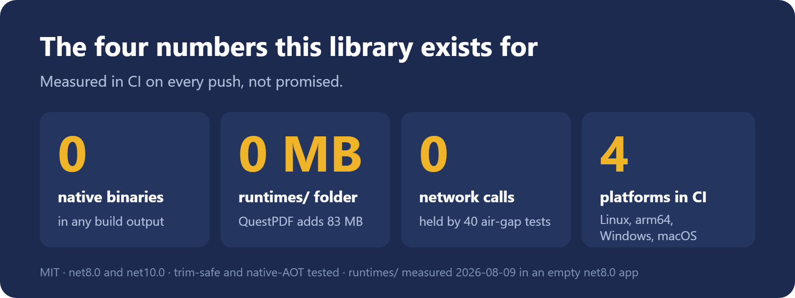
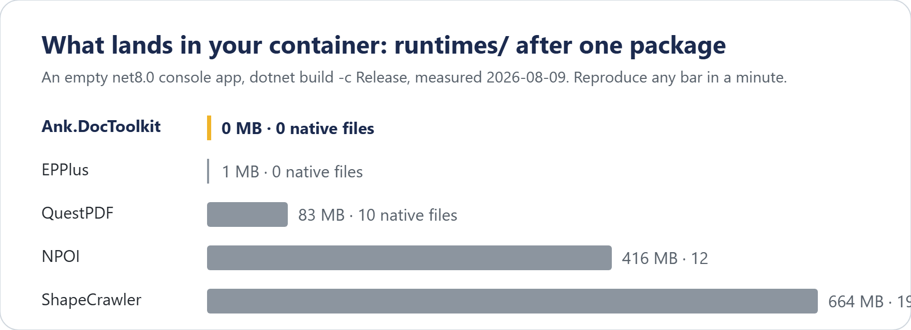

<p align="center">
  
</p>

<h1 align="center">DocToolkit</h1>

<p align="center">
  <em>HTML in. Word and PDF out. Nothing else installed.</em>
</p>

<p align="center">
  <a href="https://www.nuget.org/packages/Ank.DocToolkit/"></a>
  <a href="https://www.nuget.org/packages/Ank.DocToolkit/"></a>
  <a href="https://github.com/Ank-KhoaHo/DocToolkit/actions/workflows/ci.yml"></a>
  <a href="LICENSE"></a>
</p>

<p align="center">
  
</p>

---

You have a Linux container, a Word template and a PDF due on Friday. The usual answers are a
headless Chrome, LibreOffice, or a licence with a revenue threshold.

DocToolkit is one NuGet package instead. It is pure managed code. It restores, builds and runs the
same on your laptop and in the container.

## Install

```bash
dotnet add package Ank.DocToolkit
```

<!-- BEGIN SNIPPET: readme-quickstart -->

```csharp
// HTML in, a Word document and a PDF out. No browser, no LibreOffice, nothing to install.
byte[] docx = await HtmlToDocxConverter.ConvertAsync("<h1>Invoice 2026-114</h1>");
byte[] pdf = await HtmlToPdfConverter.ConvertAsync("<h1>Invoice 2026-114</h1>");

// Read a document back, edit one you were given, and lock it when you are done.
string text = DocxEditor.ExtractText(docx);
byte[] locked = PdfEditor.Protect(pdf, new PdfProtection { UserPassword = "s3cret" });
```

<!-- END SNIPPET -->

That is the whole setup: no browser download, no `apt-get`, no config file. It targets `net8.0` and
`net10.0`.

## Numbers

<p align="center">
  
</p>

Every bar takes a minute to reproduce. The licence column and the method sit beside the chart in
[Measured against the alternatives](https://ank-khoaho.github.io/DocToolkit/guides/reference.html#measured-against-the-alternatives).

<details>
<summary>Reproduce a bar</summary>

```bash
dotnet new console && dotnet add package <name> && dotnet build -c Release
find bin -path '*runtimes*' \( -name '*.so' -o -name '*.dylib' \) | wc -l
du -sm bin/Release/net8.0/runtimes
```

</details>

## What it does

| | |
|---|---|
| **Convert** | HTML and Markdown to DOCX and PDF; DOCX to HTML, Markdown and PDF; XLSX to CSV, HTML and PDF; PPTX to PDF; legacy Word 97-2003 `.doc` to DOCX; legacy PowerPoint 97-2003 `.ppt` to PDF ([at a measured rate](https://ank-khoaho.github.io/DocToolkit/guides/capabilities.html#legacy-binary-formats-which-the-grid-above-does-not-show)) |
| **Edit** | create and edit DOCX, XLSX and PPTX; fill templates, including one row per record; insert images; read text back out |
| **PDF** | page count, merge, split, extract, rotate, reorder, insert; read text; read and stamp document information |
| **Protect** | password-protect and unprotect PDF, DOCX, XLSX and PPTX |

<!-- BEGIN GENERATED (scripts/gen-capability-matrix.py) - do not edit by hand -->

| From ↓ / To → | CSV | DOC | DOCX | HTML | Markdown | PDF | PPTX | XLSX |
|---|---|---|---|---|---|---|---|---|
| **CSV** | — | · | · | · | · | · | · | · |
| **DOC** | · | — | **✅** | · | · | · | · | · |
| **DOCX** | · | · | — | **✅** | **✅** | **✅** | · | · |
| **HTML** | · | · | **✅** | — | · | **✅** | · | · |
| **Markdown** | · | · | **✅** | · | — | **✅** | · | · |
| **PDF** | · | · | · | · | · | — | · | · |
| **PPTX** | · | · | · | · | · | **✅** | — | · |
| **XLSX** | **✅** | · | · | **✅** | · | **✅** | · | — |

A **✅** is a converter that ships; **·** is a pair with no converter, not a promise about one. Read a row as "from this format, into these".

<!-- END GENERATED -->

## Proof

| | |
|---|---|
| **Every push** | [](https://github.com/Ank-KhoaHo/DocToolkit/actions/workflows/ci.yml) [](https://codecov.io/gh/Ank-KhoaHo/DocToolkit) on Linux, arm64, Windows and macOS |
| **Trimmable / native AOT** | both packages run-tested in CI, not just published. ClosedXML emits `IL2090`. → [Trimming and native AOT](https://ank-khoaho.github.io/DocToolkit/guides/production.html#trimming-and-native-aot) |
| **Provenance and SBOM** | every `.nupkg` and CycloneDX SBOM is attested to the workflow, commit and runner. → [Verifying a release](https://ank-khoaho.github.io/DocToolkit/guides/production.html#verifying-a-release) |
| **Offline, enforced** | 40 guard tests assert zero socket connections against 16 ways markup can name a host. → [Nothing reaches the network unless you ask](https://ank-khoaho.github.io/DocToolkit/guides/production.html#nothing-reaches-the-network-unless-you-ask) |
| **Real files** | 88–98% success across 500+ real `.gov` documents, monthly. → [Measured on documents nobody here wrote](https://ank-khoaho.github.io/DocToolkit/guides/capabilities.html#measured-on-documents-nobody-here-wrote) |
| **Free for commercial use** | 38 dependencies: 35 MIT, 2 Apache-2.0, and OfficeIMO.Core (MIT AND Apache-2.0 AND BSD-3-Clause) |

Remote images are the one network opt-in, and it stays bounded:

<!-- BEGIN SNIPPET: readme-remote-opt-in -->

```csharp
byte[] docx = await HtmlToDocxConverter.ConvertAsync(html, allowRemoteImageDownload: true);

// Bounded instead of wide open: timeout, byte cap, host allow-list and a block on
// loopback/private/link-local addresses, all on by default. Not a complete SSRF defence — see
// the Reference page.
byte[] bounded = await HtmlToDocxConverter.ConvertAsync(html, new RemoteImageOptions());
```

<!-- END SNIPPET -->

## Status

Every push is built and tested on Linux, arm64, Windows and macOS. Every release is published to
nuget.org from CI. A monthly run converts 500+ real `.gov` documents, and 88–98% succeed.

It stays below 1.0.0 on purpose, so a minor version may change the API. Each change is listed in
the [CHANGELOG](https://github.com/Ank-KhoaHo/DocToolkit/blob/main/CHANGELOG.md).

## Limits

The ones people meet first. The full list, each one measured, is in
[Known limitations](https://ank-khoaho.github.io/DocToolkit/guides/reference.html#known-limitations).

- **HTML → PDF goes through Word.** Flexbox, grid, floats and absolute positioning do not survive.
  Text, headings, tables, lists, inline styles and images do.
- **No external stylesheets.** A `<link rel="stylesheet">` is never fetched. Inline `<style>` and
  `style=` work.
- **One page setup per document.** A header or footer is one line, with an optional distinct first
  page.
- **Some PDF losses are silent.** Conditional formatting and some shape effects are dropped. A table
  nested inside a table cell loses its content.
- **Fonts come from the machine.** A container with no fonts falls back to Helvetica. Install fonts,
  or pass `PdfFontOptions`.
- **Pivot table results are never computed.** Excel fills them in when it opens the file.

## Alternatives

DocToolkit fits when the container must stay small and the licence must be clear. Something else
fits better when:

- **You need a browser's CSS layout.** A headless Chrome renders flexbox and grid. This library
  does not.
- **You need every legacy format, or a right-to-left spreadsheet.** LibreOffice or Office converts
  more faithfully, at the cost of an install.
- **You lay out a PDF in code.** QuestPDF is built for that. Read its licence, and expect 83 MB of
  native files.
- **You only edit XLSX.** EPPlus carries almost no native files. Read its licence first.

## FAQ

**Does it need Chrome or LibreOffice?**
No. Every PDF is rendered from a real Word document, in managed code.

**Can I use it at work?**
Yes. It is MIT licensed, and every dependency is MIT, Apache-2.0 or BSD.

**Which .NET versions?**
`net8.0` and `net10.0`, the two LTS releases. A `net9.0` app uses the `net8.0` build.

## Documentation

- [Guides](https://ank-khoaho.github.io/DocToolkit/guides/getting-started.html): one walkthrough per format.
- [Reference](https://ank-khoaho.github.io/DocToolkit/guides/reference.html): every capability, overload and caveat.
- [API reference](https://ank-khoaho.github.io/DocToolkit/api/DocToolkit.html), generated from the source.
- [Samples](samples/): one runnable project per capability, built against the published packages.
- [Dependency injection](src/DocToolkit.Extensions.DependencyInjection/README.md): `services.AddDocToolkit()`.
- [CHANGELOG](CHANGELOG.md) · [Roadmap](ROADMAP.md) · [Security](SECURITY.md) · [PUBLIC.md](PUBLIC.md)
- [CONTRIBUTING.md](CONTRIBUTING.md): the build, the commit rules and the four constraints.

## Licence

MIT. See [LICENSE](LICENSE). Maintained by [WillowAnk Solution](https://wanksolution.com/);
product page [wanksolution.com/doctoolkit](https://wanksolution.com/doctoolkit/).

---

If this replaced a headless browser in your build, a star helps others find it.
