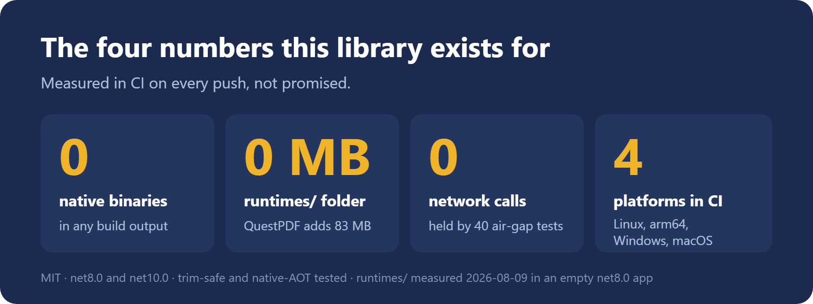
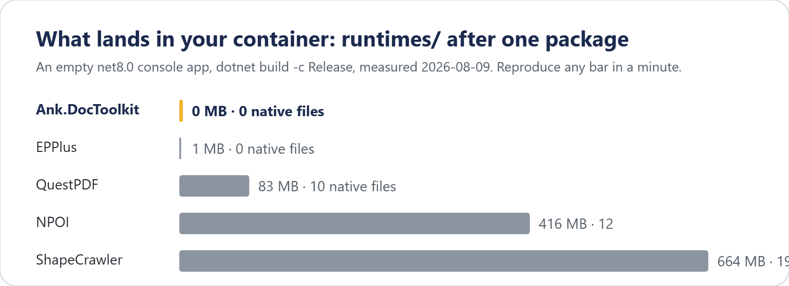

# DocToolkit

*HTML in. Word and PDF out. Nothing else installed.*

[](https://www.nuget.org/packages/Ank.DocToolkit/)
[](https://www.nuget.org/packages/Ank.DocToolkit/)
[](https://github.com/Ank-KhoaHo/DocToolkit/actions/workflows/ci.yml)
[](https://github.com/Ank-KhoaHo/DocToolkit/blob/main/LICENSE)

You have a Linux container, a Word template and a PDF due on Friday. The usual answers are a
headless Chrome, LibreOffice, or a licence with a revenue threshold.

DocToolkit is one NuGet package instead. It is pure managed code. It restores, builds and runs the
same on your laptop and in the container.

## Install

```bash
dotnet add package Ank.DocToolkit
```

<!-- BEGIN SNIPPET: readme-quickstart -->

```csharp
// HTML in, a Word document and a PDF out. No browser, no LibreOffice, nothing to install.
byte[] docx = await HtmlToDocxConverter.ConvertAsync("<h1>Invoice 2026-114</h1>");
byte[] pdf = await HtmlToPdfConverter.ConvertAsync("<h1>Invoice 2026-114</h1>");

// Read a document back, edit one you were given, and lock it when you are done.
string text = DocxEditor.ExtractText(docx);
byte[] locked = PdfEditor.Protect(pdf, new PdfProtection { UserPassword = "s3cret" });
```

<!-- END SNIPPET -->

That is the whole setup: no browser download, no `apt-get`, no config file. It targets `net8.0` and
`net10.0`.

## Numbers



Every bar takes a minute to reproduce. Add the package to an empty `net8.0` app, build it, and
measure `runtimes/`. The commands are in
[Measured against the alternatives](https://ank-khoaho.github.io/DocToolkit/guides/reference.html#measured-against-the-alternatives).

## What it does

| | |
|---|---|
| **Convert** | HTML and Markdown to DOCX and PDF; DOCX to HTML, Markdown and PDF; XLSX to CSV, HTML and PDF; PPTX to PDF; legacy Word 97-2003 `.doc` to DOCX; legacy PowerPoint 97-2003 `.ppt` to PDF |
| **Edit** | create and edit DOCX, XLSX and PPTX; fill templates and forms, including one row per record; insert images; read text back out |
| **PDF** | page count, merge, split, extract, rotate, reorder, insert; read text; read and stamp document information |
| **Protect** | password-protect and unprotect PDF, DOCX, XLSX and PPTX |

<!-- BEGIN GENERATED (scripts/gen-capability-matrix.py) - do not edit by hand -->

| From ↓ / To → | CSV | DOC | DOCX | HTML | Markdown | PDF | PPTX | XLSX |
|---|---|---|---|---|---|---|---|---|
| **CSV** | — | · | · | · | · | · | · | · |
| **DOC** | · | — | **✅** | · | · | · | · | · |
| **DOCX** | · | · | — | **✅** | **✅** | **✅** | · | · |
| **HTML** | · | · | **✅** | — | · | **✅** | · | · |
| **Markdown** | · | · | **✅** | · | — | **✅** | · | · |
| **PDF** | · | · | · | · | · | — | · | · |
| **PPTX** | · | · | · | · | · | **✅** | — | · |
| **XLSX** | **✅** | · | · | **✅** | · | **✅** | · | — |

A **✅** is a converter that ships; **·** is a pair with no converter, not a promise about one. Read a row as "from this format, into these".

<!-- END GENERATED -->

## Status

Every push is built and tested on Linux, arm64, Windows and macOS. Every release is published to
nuget.org from CI. A monthly run converts 500+ real `.gov` documents, and 88–98% succeed.

It stays below 1.0.0 on purpose, so a minor version may change the API. Each change is listed in
the [CHANGELOG](https://github.com/Ank-KhoaHo/DocToolkit/blob/main/CHANGELOG.md).

## Limits

The ones people meet first. The full list, each one measured, is in
[Known limitations](https://ank-khoaho.github.io/DocToolkit/guides/reference.html#known-limitations).

- **HTML → PDF goes through Word.** Flexbox, grid, floats and absolute positioning do not survive.
  Text, headings, tables, lists, inline styles and images do.
- **No external stylesheets.** A `<link rel="stylesheet">` is never fetched. Inline `<style>` and
  `style=` work.
- **One page setup per document.** A header or footer is one line, with an optional distinct first
  page.
- **Some PDF losses are silent.** Conditional formatting and some shape effects are dropped. A table
  nested inside a table cell loses its content.
- **Fonts come from the machine.** A container with no fonts falls back to Helvetica. Install fonts,
  or pass `PdfFontOptions`.
- **Pivot table results are never computed.** Excel fills them in when it opens the file.

## Alternatives

DocToolkit fits when the container must stay small and the licence must be clear. Something else
fits better when:

- **You need a browser's CSS layout.** A headless Chrome renders flexbox and grid. This library
  does not.
- **You need every legacy format, or a right-to-left spreadsheet.** LibreOffice or Office converts
  more faithfully, at the cost of an install.
- **You lay out a PDF in code.** QuestPDF is built for that. Read its licence, and expect 83 MB of
  native files.
- **You only edit XLSX.** EPPlus carries almost no native files. Read its licence first.

## FAQ

**Does it need Chrome or LibreOffice?**
No. Every PDF is rendered from a real Word document, in managed code.

**Can I use it at work?**
Yes. It is MIT licensed, and every dependency is MIT, Apache-2.0 or BSD.

**Does it reach the network?**
Not by default. Remote images are the one opt-in, and that stays bounded.

**Is it trim-safe and ready for native AOT?**
Yes. CI publishes a trimmed and a native-AOT app and runs both. ClosedXML still emits warning
`IL2090`.

## Learn more

- [Guides](https://ank-khoaho.github.io/DocToolkit/guides/getting-started.html): getting started,
  HTML, Markdown, Word, spreadsheets, dependency injection and production.
- [Reference](https://ank-khoaho.github.io/DocToolkit/guides/reference.html): every capability,
  every overload, the caveats and the migration notes.
- [API reference](https://ank-khoaho.github.io/DocToolkit/api/DocToolkit.html), generated from the
  source.
- [Source, samples and issues](https://github.com/Ank-KhoaHo/DocToolkit) on GitHub.

## Every type in the package

Each name links to its API page.

<!-- BEGIN GENERATED (scripts/gen-type-index.py) - do not edit by hand -->
### Core

[`DocToDocxConverter`](https://ank-khoaho.github.io/DocToolkit/api/DocToolkit.DocToDocxConverter.html), [`DocxToHtmlConverter`](https://ank-khoaho.github.io/DocToolkit/api/DocToolkit.DocxToHtmlConverter.html), [`DocxToMarkdownConverter`](https://ank-khoaho.github.io/DocToolkit/api/DocToolkit.DocxToMarkdownConverter.html), [`DocxToPdfConverter`](https://ank-khoaho.github.io/DocToolkit/api/DocToolkit.DocxToPdfConverter.html), [`DocxToPdfPreflight`](https://ank-khoaho.github.io/DocToolkit/api/DocToolkit.DocxToPdfPreflight.html), [`DocxToPdfPreflightFinding`](https://ank-khoaho.github.io/DocToolkit/api/DocToolkit.DocxToPdfPreflightFinding.html), [`DocxToPdfPreflightReport`](https://ank-khoaho.github.io/DocToolkit/api/DocToolkit.DocxToPdfPreflightReport.html), [`DocxToPdfRisk`](https://ank-khoaho.github.io/DocToolkit/api/DocToolkit.DocxToPdfRisk.html), [`HtmlToDocxConverter`](https://ank-khoaho.github.io/DocToolkit/api/DocToolkit.HtmlToDocxConverter.html), [`HtmlToPdfConverter`](https://ank-khoaho.github.io/DocToolkit/api/DocToolkit.HtmlToPdfConverter.html), [`MarkdownEditor`](https://ank-khoaho.github.io/DocToolkit/api/DocToolkit.MarkdownEditor.html), [`MarkdownHeading`](https://ank-khoaho.github.io/DocToolkit/api/DocToolkit.MarkdownHeading.html), [`MarkdownToDocxConverter`](https://ank-khoaho.github.io/DocToolkit/api/DocToolkit.MarkdownToDocxConverter.html), [`MarkdownToPdfConverter`](https://ank-khoaho.github.io/DocToolkit/api/DocToolkit.MarkdownToPdfConverter.html), [`PptxToPdfConverter`](https://ank-khoaho.github.io/DocToolkit/api/DocToolkit.PptxToPdfConverter.html), [`XlsxToCsvConverter`](https://ank-khoaho.github.io/DocToolkit/api/DocToolkit.XlsxToCsvConverter.html), [`XlsxToHtmlConverter`](https://ank-khoaho.github.io/DocToolkit/api/DocToolkit.XlsxToHtmlConverter.html), [`XlsxToPdfConverter`](https://ank-khoaho.github.io/DocToolkit/api/DocToolkit.XlsxToPdfConverter.html)

### Word (DOCX)

[`DocxBlock`](https://ank-khoaho.github.io/DocToolkit/api/DocToolkit.DocxBlock.html), [`DocxComment`](https://ank-khoaho.github.io/DocToolkit/api/DocToolkit.DocxComment.html), [`DocxCompare`](https://ank-khoaho.github.io/DocToolkit/api/DocToolkit.DocxCompare.html), [`DocxEditor`](https://ank-khoaho.github.io/DocToolkit/api/DocToolkit.DocxEditor.html), [`DocxForm`](https://ank-khoaho.github.io/DocToolkit/api/DocToolkit.DocxForm.html), [`DocxFormField`](https://ank-khoaho.github.io/DocToolkit/api/DocToolkit.DocxFormField.html), [`DocxFormIssue`](https://ank-khoaho.github.io/DocToolkit/api/DocToolkit.DocxFormIssue.html), [`DocxFormIssueKind`](https://ank-khoaho.github.io/DocToolkit/api/DocToolkit.DocxFormIssueKind.html), [`DocxFormKey`](https://ank-khoaho.github.io/DocToolkit/api/DocToolkit.DocxFormKey.html), [`DocxFormReport`](https://ank-khoaho.github.io/DocToolkit/api/DocToolkit.DocxFormReport.html), [`DocxFormValidation`](https://ank-khoaho.github.io/DocToolkit/api/DocToolkit.DocxFormValidation.html), [`DocxFormValue`](https://ank-khoaho.github.io/DocToolkit/api/DocToolkit.DocxFormValue.html), [`DocxFormValueKind`](https://ank-khoaho.github.io/DocToolkit/api/DocToolkit.DocxFormValueKind.html), [`DocxMailMerge`](https://ank-khoaho.github.io/DocToolkit/api/DocToolkit.DocxMailMerge.html), [`DocxMailMergeBatchItem`](https://ank-khoaho.github.io/DocToolkit/api/DocToolkit.DocxMailMergeBatchItem.html), [`DocxMailMergeBlockData`](https://ank-khoaho.github.io/DocToolkit/api/DocToolkit.DocxMailMergeBlockData.html), [`DocxMailMergeBlockReport`](https://ank-khoaho.github.io/DocToolkit/api/DocToolkit.DocxMailMergeBlockReport.html), [`DocxMailMergeBlockResult`](https://ank-khoaho.github.io/DocToolkit/api/DocToolkit.DocxMailMergeBlockResult.html), [`DocxMailMergeField`](https://ank-khoaho.github.io/DocToolkit/api/DocToolkit.DocxMailMergeField.html), [`DocxMailMergeFieldStatus`](https://ank-khoaho.github.io/DocToolkit/api/DocToolkit.DocxMailMergeFieldStatus.html), [`DocxMailMergeFileBatchItem`](https://ank-khoaho.github.io/DocToolkit/api/DocToolkit.DocxMailMergeFileBatchItem.html), [`DocxMailMergeIssue`](https://ank-khoaho.github.io/DocToolkit/api/DocToolkit.DocxMailMergeIssue.html), [`DocxMailMergeIssueKind`](https://ank-khoaho.github.io/DocToolkit/api/DocToolkit.DocxMailMergeIssueKind.html), [`DocxMailMergeReport`](https://ank-khoaho.github.io/DocToolkit/api/DocToolkit.DocxMailMergeReport.html), [`DocxMailMergeResult`](https://ank-khoaho.github.io/DocToolkit/api/DocToolkit.DocxMailMergeResult.html), [`DocxMailMergeTableRowGroup`](https://ank-khoaho.github.io/DocToolkit/api/DocToolkit.DocxMailMergeTableRowGroup.html), [`DocxMailMergeTemplate`](https://ank-khoaho.github.io/DocToolkit/api/DocToolkit.DocxMailMergeTemplate.html), [`DocxReview`](https://ank-khoaho.github.io/DocToolkit/api/DocToolkit.DocxReview.html), [`DocxReviewReport`](https://ank-khoaho.github.io/DocToolkit/api/DocToolkit.DocxReviewReport.html), [`DocxRevision`](https://ank-khoaho.github.io/DocToolkit/api/DocToolkit.DocxRevision.html), [`DocxRevisionKind`](https://ank-khoaho.github.io/DocToolkit/api/DocToolkit.DocxRevisionKind.html)

### PDF

[`PdfBounds`](https://ank-khoaho.github.io/DocToolkit/api/DocToolkit.PdfBounds.html), [`PdfEditor`](https://ank-khoaho.github.io/DocToolkit/api/DocToolkit.PdfEditor.html), [`PdfEncryptionStrength`](https://ank-khoaho.github.io/DocToolkit/api/DocToolkit.PdfEncryptionStrength.html), [`PdfImage`](https://ank-khoaho.github.io/DocToolkit/api/DocToolkit.PdfImage.html), [`PdfMetadata`](https://ank-khoaho.github.io/DocToolkit/api/DocToolkit.PdfMetadata.html), [`PdfProtection`](https://ank-khoaho.github.io/DocToolkit/api/DocToolkit.PdfProtection.html), [`PdfWord`](https://ank-khoaho.github.io/DocToolkit/api/DocToolkit.PdfWord.html)

### PowerPoint (PPTX)

[`PptxSlide`](https://ank-khoaho.github.io/DocToolkit/api/DocToolkit.PptxSlide.html), [`PresentationEditor`](https://ank-khoaho.github.io/DocToolkit/api/DocToolkit.PresentationEditor.html)

### Excel (XLSX)

[`PivotDataField`](https://ank-khoaho.github.io/DocToolkit/api/DocToolkit.PivotDataField.html), [`PivotFunction`](https://ank-khoaho.github.io/DocToolkit/api/DocToolkit.PivotFunction.html), [`WorkbookEditor`](https://ank-khoaho.github.io/DocToolkit/api/DocToolkit.WorkbookEditor.html), [`XlsxComment`](https://ank-khoaho.github.io/DocToolkit/api/DocToolkit.XlsxComment.html), [`XlsxFormat`](https://ank-khoaho.github.io/DocToolkit/api/DocToolkit.XlsxFormat.html), [`XlsxFormula`](https://ank-khoaho.github.io/DocToolkit/api/DocToolkit.XlsxFormula.html), [`XlsxFormulaCell`](https://ank-khoaho.github.io/DocToolkit/api/DocToolkit.XlsxFormulaCell.html), [`XlsxFormulaInspection`](https://ank-khoaho.github.io/DocToolkit/api/DocToolkit.XlsxFormulaInspection.html), [`XlsxFreeze`](https://ank-khoaho.github.io/DocToolkit/api/DocToolkit.XlsxFreeze.html), [`XlsxHighlight`](https://ank-khoaho.github.io/DocToolkit/api/DocToolkit.XlsxHighlight.html), [`XlsxHyperlink`](https://ank-khoaho.github.io/DocToolkit/api/DocToolkit.XlsxHyperlink.html), [`XlsxPageOrientation`](https://ank-khoaho.github.io/DocToolkit/api/DocToolkit.XlsxPageOrientation.html), [`XlsxPageSetup`](https://ank-khoaho.github.io/DocToolkit/api/DocToolkit.XlsxPageSetup.html), [`XlsxRule`](https://ank-khoaho.github.io/DocToolkit/api/DocToolkit.XlsxRule.html), [`XlsxRuleKind`](https://ank-khoaho.github.io/DocToolkit/api/DocToolkit.XlsxRuleKind.html), [`XlsxSheet`](https://ank-khoaho.github.io/DocToolkit/api/DocToolkit.XlsxSheet.html), [`XlsxSparkline`](https://ank-khoaho.github.io/DocToolkit/api/DocToolkit.XlsxSparkline.html), [`XlsxSparklineKind`](https://ank-khoaho.github.io/DocToolkit/api/DocToolkit.XlsxSparklineKind.html), [`XlsxTable`](https://ank-khoaho.github.io/DocToolkit/api/DocToolkit.XlsxTable.html), [`XlsxTableStyle`](https://ank-khoaho.github.io/DocToolkit/api/DocToolkit.XlsxTableStyle.html), [`XlsxValidation`](https://ank-khoaho.github.io/DocToolkit/api/DocToolkit.XlsxValidation.html), [`XlsxValidationKind`](https://ank-khoaho.github.io/DocToolkit/api/DocToolkit.XlsxValidationKind.html)

### Shared types

[`ChartData`](https://ank-khoaho.github.io/DocToolkit/api/DocToolkit.ChartData.html), [`ChartSeries`](https://ank-khoaho.github.io/DocToolkit/api/DocToolkit.ChartSeries.html), [`ChartType`](https://ank-khoaho.github.io/DocToolkit/api/DocToolkit.ChartType.html), [`ConversionLossKind`](https://ank-khoaho.github.io/DocToolkit/api/DocToolkit.ConversionLossKind.html), [`ConversionResult<T>`](https://ank-khoaho.github.io/DocToolkit/api/DocToolkit.ConversionResult-1.html), [`ConversionWarning`](https://ank-khoaho.github.io/DocToolkit/api/DocToolkit.ConversionWarning.html), [`DocToolkitTelemetry`](https://ank-khoaho.github.io/DocToolkit/api/DocToolkit.DocToolkitTelemetry.html), [`DocumentConversionException`](https://ank-khoaho.github.io/DocToolkit/api/DocToolkit.DocumentConversionException.html), [`DocumentMetadata`](https://ank-khoaho.github.io/DocToolkit/api/DocToolkit.DocumentMetadata.html), [`DocumentSignatureInfo`](https://ank-khoaho.github.io/DocToolkit/api/DocToolkit.DocumentSignatureInfo.html), [`DocumentSignatureStatus`](https://ank-khoaho.github.io/DocToolkit/api/DocToolkit.DocumentSignatureStatus.html), [`DocumentSignatureValidationOptions`](https://ank-khoaho.github.io/DocToolkit/api/DocToolkit.DocumentSignatureValidationOptions.html), [`DocumentSignatureValidationReport`](https://ank-khoaho.github.io/DocToolkit/api/DocToolkit.DocumentSignatureValidationReport.html), [`DocumentSignatureValidationResult`](https://ank-khoaho.github.io/DocToolkit/api/DocToolkit.DocumentSignatureValidationResult.html), [`DocxHeader`](https://ank-khoaho.github.io/DocToolkit/api/DocToolkit.DocxHeader.html), [`DocxHeaderSegment`](https://ank-khoaho.github.io/DocToolkit/api/DocToolkit.DocxHeaderSegment.html), [`HeaderAlignment`](https://ank-khoaho.github.io/DocToolkit/api/DocToolkit.HeaderAlignment.html), [`HtmlToPdfOptions`](https://ank-khoaho.github.io/DocToolkit/api/DocToolkit.HtmlToPdfOptions.html), [`LegacyDocOptions`](https://ank-khoaho.github.io/DocToolkit/api/DocToolkit.LegacyDocOptions.html), [`PageSetup`](https://ank-khoaho.github.io/DocToolkit/api/DocToolkit.PageSetup.html), [`PdfFontOptions`](https://ank-khoaho.github.io/DocToolkit/api/DocToolkit.PdfFontOptions.html), [`RemoteImageOptions`](https://ank-khoaho.github.io/DocToolkit/api/DocToolkit.RemoteImageOptions.html)
<!-- END GENERATED -->
