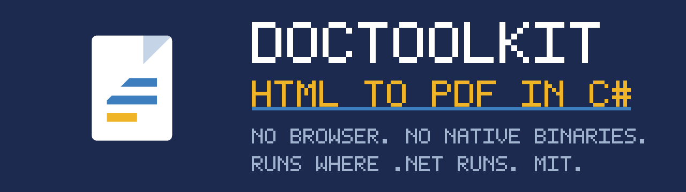

# DocToolkit



[](https://www.nuget.org/packages/Ank.DocToolkit/)
[](https://www.nuget.org/packages/Ank.DocToolkit/)
[](https://github.com/Ank-KhoaHo/DocToolkit/blob/main/LICENSE)

Generating Word, Excel, PowerPoint or PDF files from .NET usually means one of these:

- `System.Drawing.Common` throwing **`PlatformNotSupportedException`** the first time your container
  runs on Linux — it restored fine, it built fine, and it fails at runtime;
- a library whose licence is not permissive for commercial use — **EPPlus** is Polyform
  Noncommercial, **Syncfusion**'s community licence is revenue-gated, and **Spire** and
  **IronPDF** are commercial products;
- installing **LibreOffice** or a headless **Chromium** into your image to render a PDF, and owning
  a few hundred MB and a CVE feed for the privilege;
- or discovering the package downloads fonts or images at runtime, on a machine with no route out.

**DocToolkit exists because all four are avoidable.**

<!-- BEGIN GENERATED (scripts/gen-capability-matrix.py) - do not edit by hand -->

| From ↓ / To → | CSV | DOC | DOCX | HTML | Markdown | PDF | PPTX | XLSX |
|---|---|---|---|---|---|---|---|---|
| **CSV** | — | · | · | · | · | · | · | · |
| **DOC** | · | — | **✅** | · | · | · | · | · |
| **DOCX** | · | · | — | **✅** | **✅** | **✅** | · | · |
| **HTML** | · | · | **✅** | — | · | **✅** | · | · |
| **Markdown** | · | · | **✅** | · | — | **✅** | · | · |
| **PDF** | · | · | · | · | · | — | · | · |
| **PPTX** | · | · | · | · | · | **✅** | — | · |
| **XLSX** | **✅** | · | · | **✅** | · | **✅** | · | — |

A **✅** is a converter that ships; **·** is a pair with no converter, not a promise about one. Read a row as "from this format, into these".

<!-- END GENERATED -->

Plus PDF text extraction, open/edit for DOCX, XLSX and PPTX, and password protection for all
four — from .NET, with:

| | |
|---|---|
| **Permissive licences only** | MIT / Apache-2.0. No revenue thresholds, no per-seat fees, nothing to read twice. |
| **No native binaries** | `dotnet restore` is the whole install. No browser, no LibreOffice, no Office interop. |
| **Runs everywhere .NET does** | The full suite runs in CI on Linux, Windows, macOS and **arm64** — measured on each, not inferred. |
| **No runtime network I/O** | Nothing opens a socket by default. Proven by an air-gap suite that points markup at a loopback listener sixteen ways and asserts **zero** connections — including tests that assert a fetch *does* happen, so the zero can never pass vacuously. |

All four are properties of the *resolved dependency graph*, so CI re-checks every one on every push.

Install and usage come first below, deliberately. The measurements behind those four claims are at
the end of this page rather than the top — corpus pass rates on files the library has never seen,
the comparison against the alternatives, how the offline guarantee is built, and what conversions
actually cost in memory.

## Install

```bash
dotnet add package Ank.DocToolkit
```

Targets `net8.0` and `net10.0` — two LTS releases, one public API surface.

Verified in CI on Linux (x64 and **arm64**), Windows and macOS.

**Trim-safe and native-AOT compatible**, and both claims are earned the same way: CI publishes a
probe application — trimmed in one job, native-AOT in the other — and *runs* it, asserting every
capability's result. Neither trimming nor AOT fails at publish time when it fails; it removes a
type something resolves by name and the app throws, or silently produces an empty document, in
production. One caveat that is a dependency's rather than ours: **ClosedXML emits `IL2090`** under
both, and will appear in your publish output.

📖 **[Guides](https://ank-khoaho.github.io/DocToolkit/guides/getting-started.html)** — getting
started, HTML conversion and page setup, Word templates, spreadsheets and presentations,
dependency injection, and running in production ·
🔎 **[API reference](https://ank-khoaho.github.io/DocToolkit/)**
